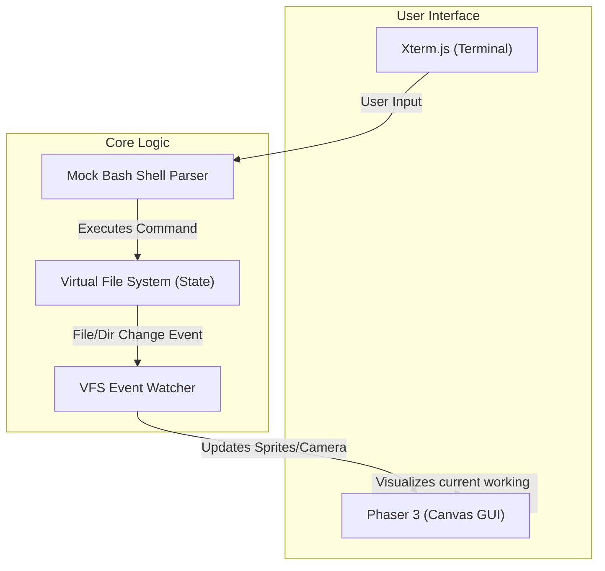

# System Architecture

The application is built on three main pillars: the Terminal UI, the Virtual File System (VFS), and the Game Engine.

## State Management
- **Source of Truth:** The Virtual File System (VFS) is the absolute source of truth. Phaser does not manage player position. The player's position is simply the VFS `currentWorkingDirectory`.
- **Event Bus:** Use a simple EventEmitter to bridge the VFS and Phaser.
  - Events: `onDirectoryChange(path)`, `onFileCreated(file)`, `onFileDeleted(file)`.
